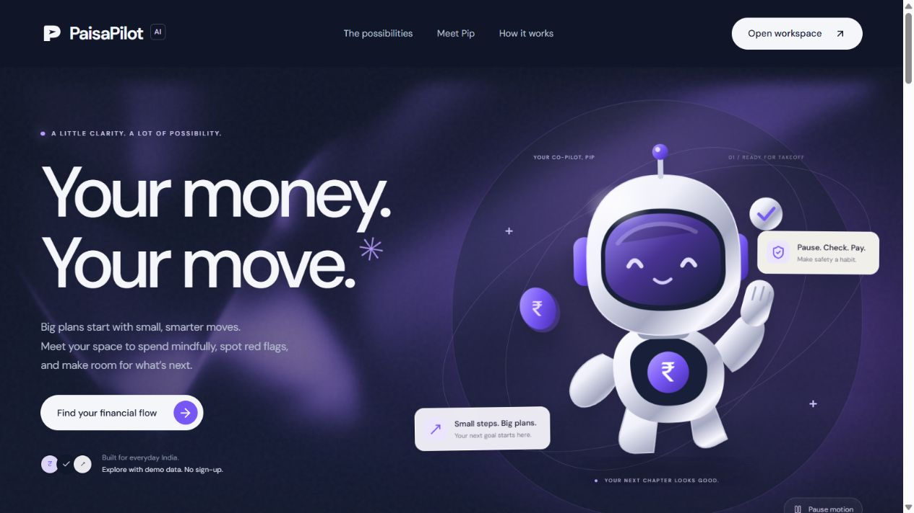
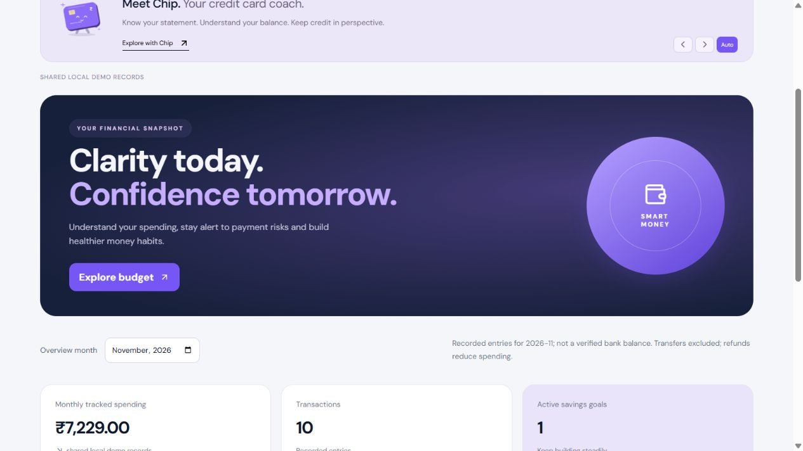

# PaisaPilot AI

**Understand your spending. See the evidence. Build better money habits.**

[Open the live demo](https://paisapilot-ai-amruta-launch.perfectturaco256.chatgpt.site) · [Judge walkthrough](docs/JUDGING.md) · [Architecture and API status](docs/STATUS.md) · [Local setup](docs/RUNNING.md)

PaisaPilot is an India-focused educational finance MVP for the **AI for Finance** hackathon theme. It combines reviewed transaction imports, transparent budgeting, savings goals and payment-safety education with Pip, an optional AI explainer. All demonstrations use synthetic records. No real-money trading is provided.



## What you can try

- Review CSV or pasted transaction/SMS text before importing; correct mappings and amounts, inspect duplicates, undo and restore an import.
- Compare monthly income, expenses, refunds and cash flow. Evidence panels expose the records, arithmetic and assumptions behind totals.
- Set category budgets and record savings-goal contributions with history.
- Explore explainable UPI risk signals, credit-card arithmetic, illustrative GST/invoice drafts, mutual-fund NAV history and currency reference rates.
- Navigate with a collapsible sidebar. Pip, Mint, Chip and Sentinel introduce relevant tools; motion can be paused and respects reduced-motion preferences.
- Export or delete workspace records. The hosted demo uses isolated browser workspaces; managed sign-in is implemented for private workspaces.

Pip adds plain-language explanations to deterministic calculations. AI does not calculate the financial ledger or execute payments. General explanations send a fixed topic only. Private financial summaries require consent and send six aggregate values, not transaction descriptions or account numbers.



## Two runtimes, clearly separated

| Source | Purpose | Backend / storage |
| --- | --- | --- |
| `hosted/` | Source snapshot of the permanent live website | Cloudflare Worker, D1 SQLite, platform-managed sign-in |
| `frontend/`, `backend/`, `scripts/` | Independently runnable local app | React/Vite, FastAPI, owner-scoped SQLite, optional Supabase sign-in |

The live website does **not** run FastAPI or use Supabase for its hosted database. This GitHub repository is the submission mirror; pushing here does not automatically redeploy the managed site. No private local records, account keys or database files are included.

## Run locally

Use Python 3.12 and Node.js 24. From the repository root on Windows:

```powershell
python -m venv backend/.venv
backend/.venv/Scripts/python.exe -m pip install -r backend/requirements.txt -r backend/requirements-dev.txt
npm.cmd --prefix frontend ci
python scripts/run_local.py --demo
```

Open **http://127.0.0.1:8001/**. Keep the terminal running. This isolated local sample mode needs no account keys; optional external AI is disabled by default. It differs from the hosted per-browser demo: local sample records are shared by visitors to that local server. See [full setup](docs/RUNNING.md) for private sign-in and backup commands.

To reproduce the hosted source checks (its backend requires the managed Worker/D1 environment):

```powershell
cd hosted
npm.cmd ci
npm.cmd run test
npm.cmd run test:server
npm.cmd run build
```

`npm run dev` in `hosted/` serves frontend assets only; use the live site for its hosted API or the FastAPI instructions above for a complete local app.

## Verification and honest limits

Recorded checks: **103 FastAPI tests, 63 hosted UI tests and 12 hosted API contract tests passed**; production builds passed. Hosted contract tests use a SQLite-backed D1 adapter, not a live Cloudflare environment. See [verification details](docs/STATUS.md).

Live browser checks covered dashboard loading, import preview/commit, undo/restore, saved budgets and currency conversion. Gemini is configured server-side, but a successful reply from the final hosted deployment remains **unverified** after earlier timeouts. Private sign-in acceptance and backup recovery drills also remain pending. Upstox is not connected. There is no automatic bank/UPI sync, tax filing, full portfolio analysis or backtesting engine.

UPI screening is an educational heuristic, not confirmed fraud detection. Reference rates and NAVs are dated data, not executable quotes. GST and credit calculations are illustrations, not filing or lending advice. This MVP is not certified production financial infrastructure.

## Screenshots and attribution

Screenshots show synthetic demonstration data. Dashboard and mobile captures are from the local runtime sharing the hosted design; the credit screen is a hosted capture. They document actual screens rather than design mockups.

[Mobile layout](docs/screenshots/mobile.jpg) · [Hosted credit screen](docs/screenshots/hosted-credit.jpg)

Dark Veil is adapted from React Bits; its attribution and MIT license are retained in each frontend's `src/vendor/react-bits/`. Other dependencies retain their respective licenses. Mascots are local SVG components. See [design notes](docs/DESIGN.md).
