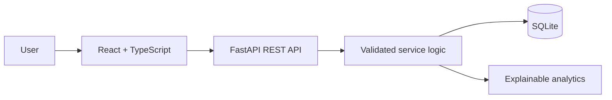

# Architecture

## Frontend
The React app provides navigation for Overview, Budget, UPI Safety, Market Lab, Business Desk, Goals and Learn. API access is centralised in `src/api.ts`; the base URL is configurable with `VITE_API_BASE_URL`.

## Backend
- `app/main.py`: FastAPI app, CORS and health route.
- `app/database.py`: SQLite connection and schema initialisation.
- `app/schemas.py`: Pydantic request validation.
- `app/routers/api.py`: domain endpoints.
- `app/services/analytics.py`: transparent heuristic and historical indicator calculations.

## Integration rules
- Display API-backed values, not invented live account data.
- The UI only reports a write as successful after the API responds.
- Seed data is synthetic demo data and clearly labelled.
- Market Lab accepts historical user-supplied prices only.
